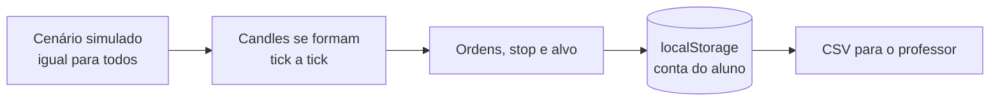

# 📈 Simulador de Negociações — Paper Trading para Sala de Aula

> Aprenda a operar **mini dólar** e **mini índice** em um mercado simulado, com dinheiro de mentira.
> Roda inteiro no navegador, é gratuito e se hospeda no GitHub Pages.

**🔗 Acesse:** https://juliohartwig.github.io/paper-trading/

<!-- Adicione uma captura de tela: salve em docs/tela.png e descomente a linha abaixo.

-->

---

## Por que este projeto existe

Quem está aprendendo a operar costuma errar com dinheiro de verdade. Este simulador foi feito para o aluno **praticar compra e venda, gestão de risco e leitura de gráfico** em um ambiente que se comporta como a plataforma de uma corretora (preços em pontos, ticks, valor do ponto), mas sem risco financeiro.

Ele foi pensado para uso em aula:

- **Sem cadastro, sem servidor, sem custo.** O aluno abre o link e opera.
- **Todos os alunos veem o mesmo cenário**, o que facilita comentar o gráfico em sala e comparar decisões.
- **Cada aluno tem a própria conta**, guardada no navegador dele.
- **O professor recebe o resultado** por um arquivo CSV exportado pelo aluno.

---

## O que dá para fazer

| Recurso | Descrição |
|---|---|
| 📊 **Gráfico de candles** | Mini dólar e mini índice, com timeframes de 1, 5 e 15 minutos (TradingView Lightweight Charts). |
| ⏱️ **Mercado simulado em tempo real** | Os preços andam em tempo real: o candle de 1 minuto leva 1 minuto para fechar e se forma aos poucos, em ticks de 0,3 a 2,5 s. Os candles de 5 e 15 minutos agrupam os mesmos preços, então o preço atual é igual em qualquer timeframe. |
| 🛒 **Compra e venda** | Ordens em lotes (1 a 100), com um pequeno atraso na execução. A ordem é executada ao preço do momento da execução, não do clique. |
| 🎯 **Stop e alvo** | Definidos na ordem ou movidos depois, com a posição aberta. Aparecem no gráfico como linhas tracejadas com o resultado em R$. A posição é encerrada automaticamente ao atingir o nível. |
| 💰 **Painel de resultados** | Saldo, resultado em aberto em tempo real, patrimônio, posições abertas e histórico com o motivo de cada saída (manual, stop ou alvo). |
| 🛡️ **Garantia e liquidação** | Cada lote aberto bloqueia R$ 25 de garantia. Se o patrimônio chegar a zero, todas as posições são encerradas automaticamente. |
| 💾 **Conta no navegador** | Saldo, posições e histórico ficam no `localStorage`. Há botão para resetar a conta. |
| 📤 **Exportar resultado** | O aluno baixa um CSV com o nome dele e o histórico de operações. |

---

## Regras de negócio

Os preços e valores seguem a referência da B3 / MetaTrader 5:

| | Mini dólar (WDO) | Mini índice (WIN) |
|---|---|---|
| Preço exibido | Pontos (ex.: `5.420,00`) | Pontos (ex.: `134.000`) |
| Tick (variação mínima) | 0,5 ponto | 5 pontos |
| Valor do tick | R$ 5,00 | R$ 1,00 |
| Valor do ponto | R$ 10,00 por lote | R$ 0,20 por lote |

**Resultado** = (pontos de saída − pontos de entrada) × valor do ponto × lotes. Na venda, o sinal se inverte.

- Compra a 134.000 e venda a 134.500 → +500 pontos × R$ 0,20 = **+R$ 100,00**
- Venda a 5.420,0 e recompra a 5.410,0 → +10 pontos × R$ 10,00 = **+R$ 100,00**

> **Conta e garantia:** o saldo inicial é de **R$ 200,00**. Cada **lote** aberto bloqueia uma **garantia de R$ 25,00** (2 lotes bloqueiam R$ 50,00), liberada quando a posição é encerrada. Só é possível abrir uma ordem se o patrimônio livre cobrir a garantia dela. Se o **patrimônio chegar a zero, todas as operações são encerradas** automaticamente.
>
> Simplificações didáticas: sem alavancagem, corretagem ou custos operacionais, e sem ordens limitadas.

---

## Como funciona por dentro



- **Tudo roda no navegador.** Não há servidor, banco de dados nem serviço externo para manter.
- **O cenário é gerado no próprio navegador** (um passeio aleatório determinístico atrelado ao relógio), então todos os alunos veem o mesmo preço no mesmo minuto, e recarregar a página não muda o preço. Os preços **não** são cotações reais.
- **Um só mercado, vários timeframes.** O simulador gera candles de 1 minuto para os dois ativos o tempo todo; os de 5 e 15 minutos são o agrupamento deles. Por isso uma posição aberta vale o mesmo em qualquer timeframe, e o stop e o alvo valem para os dois ativos, mesmo com o outro na tela.
- **Escala do MetaTrader.** Os preços são arredondados ao tick de cada ativo e exibidos em pontos.

---

## Para o professor

**Uma aula, em quatro passos:**

1. Os alunos abrem o link e escolhem o ativo e o timeframe.
2. Cada aluno opera, define stop e alvo e acompanha o resultado no painel.
3. Você comenta o gráfico com a turma, já que todos veem os mesmos candles.
4. No fim, cada um clica em **Exportar CSV** e envia o arquivo a você.

**Boas práticas:**

- Como o tempo é real, o timeframe de **1 minuto** é o mais adequado para aula: um candle de 5 minutos leva 5 minutos para fechar, e o de 15 leva 15.
- Peça que usem **sempre o mesmo navegador e aparelho**: a conta fica salva nele. Limpar os dados do navegador ou abrir uma aba anônima apaga tudo.
- Não há ranking da turma, porque isso exigiria um servidor. Para comparar resultados, use os CSVs.

---

## Rodar localmente

Requer Node.js 18 ou superior.

```bash
npm install
npm run dev
```

Abra o endereço mostrado no terminal (normalmente http://localhost:5173).

## Publicar no GitHub Pages

1. Envie o projeto para a branch `main` de um repositório.
2. **Settings → Pages → Build and deployment → Source: GitHub Actions**.
3. Envie um commit para `main` (ou rode **Actions → Deploy no GitHub Pages → Run workflow**).

O endereço final aparece em **Settings → Pages**. O workflow está em `.github/workflows/deploy.yml`. Não há chaves de API nem variáveis para configurar.

---

## Personalizar

| O que | Onde |
|---|---|
| Saldo inicial e garantia por lote | `SALDO_INICIAL` e `GARANTIA_POR_LOTE` em `src/config.js` |
| Valor do ponto, tick, casas decimais e escala de cada ativo | `ATIVOS` em `src/config.js` |
| Atraso na execução das ordens | `ATRASO_ORDEM_MS` em `src/config.js` |
| Ritmo dos ticks (0,3 a 2,5 s) | `src/data/replayConfig.js` |
| Cenário simulado (preço inicial e volatilidade) | `base` em `ATIVOS` e `criarGerador` em `src/data/candleBuilder.js` |
| Limite de lotes por ordem | `src/components/OrderPanel.jsx` |

---

## Limitações conhecidas

- **Os preços são simulados.** Servem para treinar a operação e a gestão de risco, mas não reproduzem o comportamento de um mercado real.
- **Cenário semanal.** A sequência de preços depende do relógio e recomeça do preço-base uma vez por semana (o que só afetaria quem mantivesse uma posição aberta durante essa virada).
- **Dados só no navegador.** Trocar de computador ou limpar o histórico apaga a conta. O professor não vê os resultados sem o CSV.
- **Stop e alvo** encerram a posição ao preço vigente, que pode ficar um pouco além do nível, como numa ordem a mercado.
- **Garantia e liquidação simplificadas.** A garantia é fixa por lote e a liquidação só acontece quando o patrimônio chega a zero. Se o preço der um salto além disso, o patrimônio pode ficar levemente negativo. Não há corretagem nem custos.

---

## Estrutura do projeto

```
.github/workflows/deploy.yml   deploy automático no GitHub Pages
src/
├── config.js                  ativos, escala, tick, valor do ponto, saldo
├── App.jsx                    tela principal e fluxo das ordens
├── components/                gráfico, nova ordem, posições, histórico, aviso
├── data/                      motor do mercado simulado, formação dos candles e hook useMercado
├── state/                     regras da conta (reducer) e localStorage
└── lib/                       formatação, escala de preços e exportação CSV
```

**Tecnologias:** React 18, Vite, TradingView Lightweight Charts, GitHub Actions.

---

## Próximos passos possíveis

- Velocidade do mercado simulado (1x, 5x, 20x)
- Sessões reais de mercado gravadas em arquivo, para treinar sobre dias históricos
- Relatório com taxa de acerto, maior ganho e maior perda
- Limite de lotes por patrimônio e trava quando a conta zerar
- Custos simulados (corretagem e spread)
- Backup da conta em JSON (exportar e importar)

---

> ⚠️ **Aviso:** projeto estritamente educacional. Nada aqui é recomendação de investimento, e o desempenho no simulador não garante resultado em operações reais.
