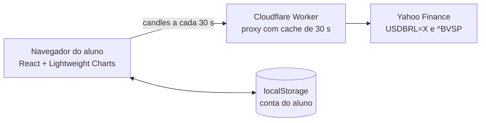

# 📈 Simulador de Negociações — Paper Trading para Sala de Aula

> Aprenda a operar **mini dólar** e **mini índice** com cotações reais e dinheiro de mentira.
> Roda inteiro no navegador, é gratuito e se hospeda no GitHub Pages.

**🔗 Acesse:** https://juliohartwig.github.io/paper-trading/

<!-- Adicione uma captura de tela: salve em docs/tela.png e descomente a linha abaixo.

-->

---

## Por que este projeto existe

Quem está aprendendo a operar costuma errar com dinheiro de verdade. Este simulador foi feito para o aluno **praticar compra e venda, gestão de risco e leitura de gráfico** em um ambiente que se comporta como a plataforma de uma corretora (preços em pontos, ticks, valor do ponto), mas sem risco financeiro.

Ele foi pensado para uso em aula:

- **Sem cadastro, sem servidor, sem custo.** O aluno abre o link e opera.
- **Cada aluno tem a própria conta**, guardada no navegador dele.
- **O professor recebe o resultado** por um arquivo CSV exportado pelo aluno.

---

## O que dá para fazer

| Recurso | Descrição |
|---|---|
| 📊 **Gráfico de candles** | Mini dólar e mini índice, com timeframes de 1, 5 e 15 minutos (TradingView Lightweight Charts). |
| 🛒 **Compra e venda** | Ordens em lotes (1 a 100), com um pequeno atraso na execução. A ordem é executada ao preço do momento da execução, não do clique. |
| 🎯 **Stop e alvo** | Definidos na ordem ou movidos depois, com a posição aberta. Aparecem no gráfico como linhas tracejadas com o resultado em R$. A posição é encerrada automaticamente ao atingir o nível. |
| 💰 **Painel de resultados** | Saldo, resultado em aberto em tempo real, patrimônio, posições abertas e histórico com o motivo de cada saída (manual, stop ou alvo). |
| 🔁 **Modo Replay** | Repete uma sessão em tempo real, candle a candle: o candle de 1 minuto dura 1 minuto, o de 5 dura 5, e assim por diante. Os ticks chegam em intervalos aleatórios de 0,3 a 2,5 s. Serve para aulas fora do pregão. |
| 💾 **Conta no navegador** | Saldo, posições e histórico ficam no `localStorage`. Há botão para resetar a conta. |
| 📤 **Exportar resultado** | O aluno baixa um CSV com o nome dele e o histórico de operações. |

---

## Regras de negócio

Os preços e valores seguem a referência da B3 / MetaTrader 5:

| | Mini dólar (WDO) | Mini índice (WIN) |
|---|---|---|
| Preço exibido | Pontos (ex.: `5.420,00`) | Pontos (ex.: `134.000`) |
| Tick (variação mínima) | 0,5 ponto | 5 pontos |
| Valor do tick | R$ 5,00 | R$ 1,00 |
| Valor do ponto | R$ 10,00 por lote | R$ 0,20 por lote |

**Resultado** = (pontos de saída − pontos de entrada) × valor do ponto × lotes. Na venda, o sinal se inverte.

- Compra a 134.000 e venda a 134.500 → +500 pontos × R$ 0,20 = **+R$ 100,00**
- Venda a 5.420,0 e recompra a 5.410,0 → +10 pontos × R$ 10,00 = **+R$ 100,00**

> Simplificações didáticas: sem margem, alavancagem, corretagem ou custos operacionais, e sem ordens limitadas. O saldo inicial é de R$ 10.000,00.

---

## Como funciona por dentro



- **Sem backend próprio.** Toda a lógica roda no navegador. O único componente fora dele é um Worker gratuito da Cloudflare, que existe só para contornar o bloqueio de CORS do Yahoo e guardar a resposta por 30 s. Assim, a turma inteira gera poucas chamadas por minuto à fonte.
- **Preços na escala do MetaTrader.** A cotação à vista (por exemplo, 5,3455) é convertida para pontos (5.345,50) e arredondada ao tick de cada ativo.
- **Dados reais com atraso** de até cerca de 15 minutos, o que é adequado para fins educacionais.

---

## Para o professor

**Uma aula, em quatro passos:**

1. Os alunos abrem o link e escolhem o ativo e o timeframe.
2. **Durante o pregão:** modo *Mercado real*. **Fora do pregão ou em fins de semana:** modo *Replay*.
3. Cada aluno opera, define stop e alvo e acompanha o resultado no painel.
4. No fim, cada um clica em **Exportar CSV** e envia o arquivo a você.

**Boas práticas:**

- Peça que usem **sempre o mesmo navegador e aparelho**: a conta fica salva nele. Limpar os dados do navegador ou abrir uma aba anônima apaga tudo.
- O Ibovespa só tem candles novos no pregão da B3 (dias úteis, em horário comercial). O dólar negocia quase 24 h em dias úteis.
- Não há ranking da turma, porque isso exigiria um servidor. Para comparar resultados, use os CSVs.

---

## Rodar localmente

Requer Node.js 18 ou superior.

```bash
npm install
cp .env.example .env     # opcional: coloque a URL do seu Worker
npm run dev
```

Abra o endereço mostrado no terminal (normalmente http://localhost:5173).

## Publicar o seu próprio simulador

### 1. Worker na Cloudflare (3 minutos, gratuito, sem cartão)

1. Crie uma conta em https://dash.cloudflare.com.
2. **Workers & Pages → Create → Create Worker**, dê um nome (ex.: `paper-trading`) e clique em **Deploy**.
3. Clique em **Edit code**, cole o conteúdo de `worker/index.js` e clique em **Deploy**.
4. Teste: abrir a URL do Worker sem parâmetros deve mostrar um texto de confirmação, e `SUA_URL/?symbol=USDBRL=X&interval=5m&range=1d` deve devolver um JSON.

O plano gratuito permite 100 mil requisições por dia.

### 2. GitHub Pages

1. Envie o projeto para a branch `main` de um repositório.
2. **Settings → Pages → Build and deployment → Source: GitHub Actions**.
3. **Settings → Secrets and variables → Actions → aba Variables → New repository variable**: nome `VITE_WORKER_URL`, valor igual à URL do Worker. (Fica na aba *Variables*, e não em *Secrets*, porque é uma URL pública.)
4. Rode o workflow em **Actions → Deploy no GitHub Pages → Run workflow**. A variável só entra no site quando ele é construído de novo.

O endereço final aparece em **Settings → Pages**. Não há chaves de API secretas neste projeto.

---

## Personalizar

Quase tudo fica em `src/config.js`:

| O que | Onde |
|---|---|
| Saldo inicial | `SALDO_INICIAL` |
| Valor do ponto, tick, casas decimais e escala de cada ativo | `ATIVOS` |
| Atraso na execução das ordens | `ATRASO_ORDEM_MS` |
| Frequência de atualização dos dados reais | `ATUALIZACAO_MS` |
| Ritmo dos ticks no Replay (0,3 a 2,5 s) | `src/data/replayConfig.js` |
| Limite de lotes por ordem | `src/components/OrderPanel.jsx` |

**Trocar a fonte de dados:** toda a busca de candles está em `src/data/yahooProvider.js`, que devolve `[{ time, open, high, low, close }]` com `time` em segundos. Crie um arquivo com a mesma função `buscarCandles(simbolo, tf)` e troque o `import` em `src/data/useMarketData.js`. Para incluir ativos novos, adicione um item em `ATIVOS` e o símbolo na lista `SIMBOLOS` de `worker/index.js`.

---

## Limitações conhecidas

- **Fonte não oficial.** O endpoint de gráficos do Yahoo pode mudar ou limitar acessos sem aviso. Se falhar, o app mostra uma mensagem e o aluno pode usar o modo Replay.
- **Preços à vista, não do contrato futuro.** O WDO e o WIN reais costumam negociar um pouco acima do dólar e do índice à vista, então os números saem parecidos, mas não idênticos aos da corretora.
- **Dados só no navegador.** Trocar de computador ou limpar o histórico apaga a conta. O professor não vê os resultados sem o CSV.
- **Stop e alvo** só são monitorados para o ativo que está na tela, e a saída é imediata ao preço vigente, que pode ficar um pouco além do nível. No mercado real, o preço é atualizado a cada 30 s.
- **Sem margem e sem custos.** Com até 100 lotes por ordem, a conta pode zerar rápido. Ajuste o limite de lotes ou o saldo conforme a turma.

---

## Estrutura do projeto

```
.github/workflows/deploy.yml   deploy automático no GitHub Pages
worker/index.js                proxy Cloudflare com cache
src/
├── config.js                  ativos, escala, tick, valor do ponto, saldo
├── App.jsx                    tela principal e fluxo das ordens
├── components/                gráfico, nova ordem, posições, histórico, avisos
├── data/                      busca de candles, Replay e hook useMarketData
├── state/                     regras da conta (reducer) e localStorage
└── lib/                       formatação, escala de preços e exportação CSV
```

**Tecnologias:** React 18, Vite, TradingView Lightweight Charts, Cloudflare Workers, GitHub Actions.

---

## Próximos passos possíveis

- Velocidade do Replay (1x, 5x, 20x)
- Série de exemplo fixa no projeto, para toda a turma operar o mesmo cenário
- Relatório com taxa de acerto, maior ganho e maior perda
- Limite de lotes por patrimônio e trava quando a conta zerar
- Custos simulados (corretagem e spread)
- Backup da conta em JSON (exportar e importar)

---

> ⚠️ **Aviso:** projeto estritamente educacional. Nada aqui é recomendação de investimento, e o desempenho no simulador não garante resultado em operações reais.
